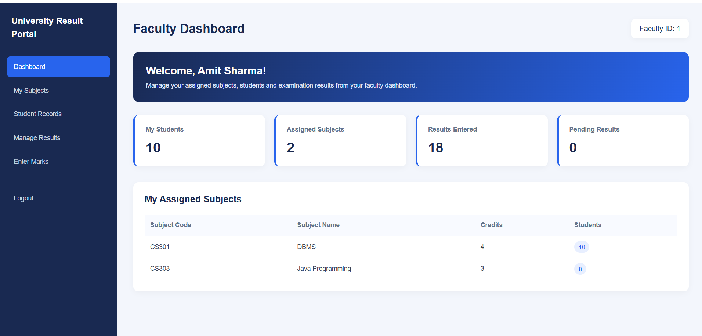
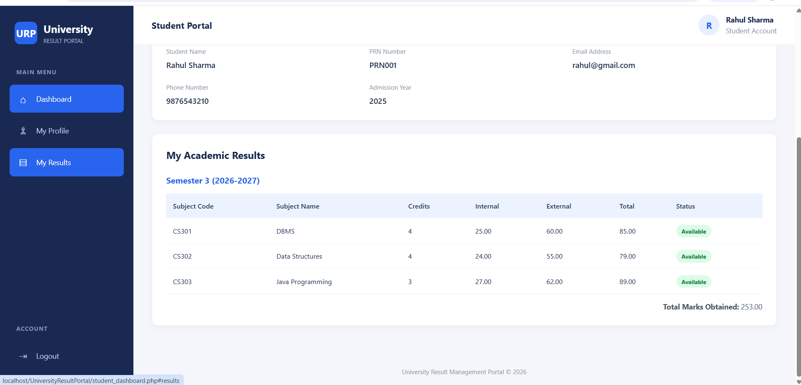
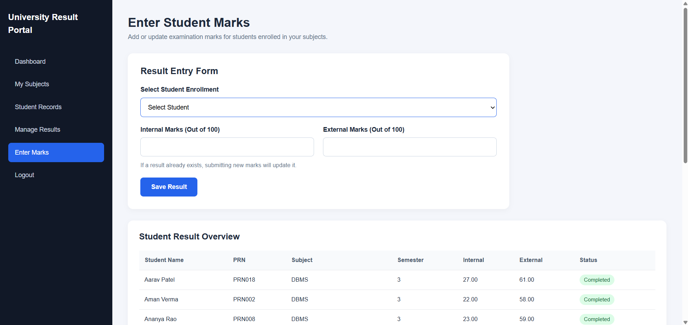
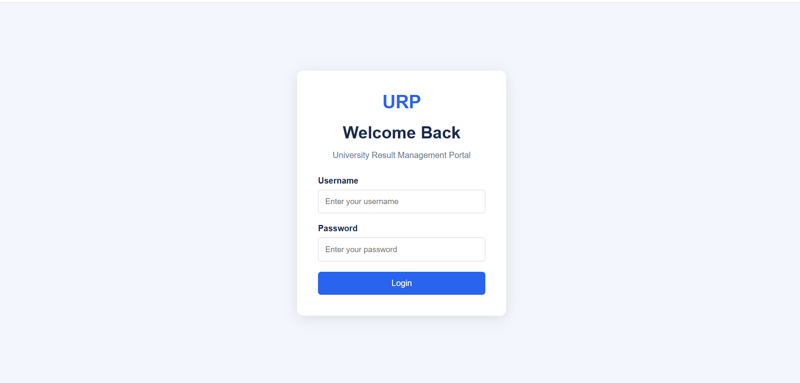

# University Result Portal

A web-based University Result Portal developed as an academic DBMS mini-project. The application allows students and administrators to manage and access student academic records through a web interface.

## Features

- Student record management
- Faculty management
- Subject and semester management
- Enrollment management
- Result entry and management
- Student result viewing using PRN
- Student search
- Dashboard with database statistics
- Database integration using PHP PDO

## Tech Stack

- **Frontend:** HTML, CSS
- **Backend:** PHP
- **Database:** MySQL
- **Database Connectivity:** PDO
- **Local Server:** XAMPP

## Project Structure

```text
UniversityResultPortal/
│
├── config/
│   └── Database configuration
│
├── index.php
├── login.php
├── logout.php
├── student_dashboard.php
├── student_result.php
├── students.php
├── faculty.php
├── subjects.php
├── semesters.php
├── enrollments.php
├── results.php
├── add_student.php
├── add_faculty.php
├── add_subject.php
├── add_semester.php
├── add_result.php
└── style.css
```

## Requirements

- XAMPP
- PHP
- MySQL
- Web browser

## Installation and Setup

1. Install XAMPP.
2. Copy the project folder into the `htdocs` directory.
3. Start Apache and MySQL using the XAMPP Control Panel.
4. Create the MySQL database named `UniversityResultPortal`.
5. Import the provided SQL database file through phpMyAdmin.
6. Configure the database connection in the configuration file.
7. Open the application in your browser:

   `http://localhost/UniversityResultPortal/`

## Database

The project uses a relational database to store and manage student, faculty, subject, semester, enrollment, and result information.

PDO is used for connecting PHP with MySQL.

## Learning Outcomes

- Relational database design
- SQL queries and joins
- PHP–MySQL connectivity
- CRUD operations
- Database-driven web application development
- Basic frontend development

## Academic Project

Developed as a DBMS mini-project as part of the Bachelor of Technology in Computer Science and Engineering curriculum.

## Screenshots

## Screenshots

### Faculty Dashboard


### Student Dashboard


### Student Result


### Faculty Enter Marks


### Login Page

